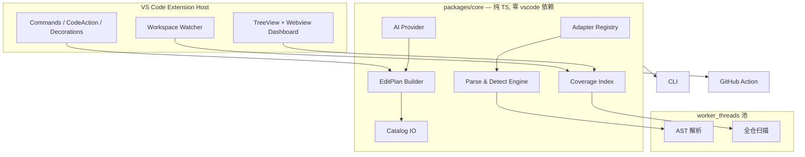

# i18n 本地化管理 VS Code 插件 · 技术规划

> 版本 v0.1 · 2026-11-03 · 状态：待评审
> 工作代号：`i18n-forge`（临时名，见 §12 待拍板事项）

---

## 0. 一页纸结论

**市场判断（已核验，见 §1）**
i18n Ally 主分支最后一次提交是 `2024-11-01`（`chore(release): 2.13.1`），npm 最新版 `2.14.0`，至今约两年无更新；技术栈停留在 webpack 4 / TypeScript 4.3 / Vue 2 编译器。

**但"提出取"这个前提需要修正**：i18n Ally 早就有硬编码字符串提取能力，只是自己标了 experimental——命令名里明写着 `Extract all hard-coded strings (experimental)`，开关 `i18n-ally.extract.autoDetect` 默认 `false`。真正的空白不是"没人做提取"，而是：

> **没人把自动提取做成"可信、可批量、可回滚、可度量"的事。**

**产品定位**
不是又一个 i18n 词条浏览器，而是 **i18n 的 codemod + 覆盖率仪表盘**。
入口是把硬编码文案扒出来；护城河是"改得对、改得可逆、改得能算清楚"。

**技术主线**
一个零 `vscode` 依赖的纯 TS 核心包 `core`，同一套引擎同时供 **VS Code 扩展 / CLI / GitHub Action** 三种出口。这一条决定了产品能不能进团队流程——i18n Ally 的单体扩展架构做不到，这是结构性优势。

**首批支持**
React（react-i18next）· Next.js App Router（next-intl）· Vue 3（vue-i18n）· 原生 TS/JS；locale 格式 JSON / JSONC / YAML。

**节奏**
2 周技术验证（Go/No-Go）→ 6 周 MVP → 4 周批量改写与评审 → CLI/CI/AI。

**最大风险**
自动改写破坏代码。对策：置信度分层、改后重解析校验、默认 dry-run、git 快照、一键全量撤销。
**宁可少改，不可改错。**

---

## 1. 事实基线（可复核）

| 项 | 事实 | 对规划的含义 |
|---|---|---|
| 最后提交 | `2024-11-01` `chore(release): 2.13.1`（作者 kibertoad） | 约两年无功能迭代 |
| 发布版本 | npm `i18n-ally@2.14.0`，仓库地址指向 `github.com/kirbo/i18n-ally` | 维护权已边缘化 |
| 引擎要求 | `engines.vscode: ^1.77.3` | 我们可要求更高版本，换取新 API |
| 构建栈 | `webpack@^4.46`、`typescript@^4.3.5`、`vue-template-compiler@^2.6`、`parcel-bundler` | 现代工具链可直接拉开性能与体积差距 |
| 框架适配 | `enabledFrameworks` 支持 30 项（vue / react / next-intl / next-translate / svelte / flutter / laravel / transloco …） | 覆盖广度是它的存量优势，不能硬碰，要"少而深" |
| 提取配置 | `extract.autoDetect`(默认 false)、`extract.keygenStrategy`(slug/random/empty/source)、`extract.keygenStyle`、`extract.keyPrefix`、`extract.ignored`、`extract.ignoredByFiles`、`extract.targetPickingStrategy`、`extract.keyMaxLength`、`refactor.templates` | 说明它有"半成品"，缺少的是可靠性与批量体验 |
| 提取命令 | `i18n-ally.detect_hard_strings`、`i18n-ally.extract-hard-strings-batch`，标题均含 experimental | 官方自认未成熟 |
| 改写方式 | `refactor.templates` 用 `source`（html-attribute / html-inline / js-string / js-template / jsx-text）+ 模板字符串拼输出 | **模板拼接而非 AST 重写**，无作用域分析，这是它的根本缺陷 |
| 翻译引擎 | google / deepl / baidu / libretranslate / openai；`openai.apiModel` 枚举止于 `gpt-4-32k`，默认 `gpt-3.5-turbo` | AI 能力停留在 2023 年 |
| 许可证 | MIT（Lokalise Inc. / Anthony Fu / think2011） | **可合法移植适配规则**，需保留版权声明 |
| 已有能力 | 内联注解、Review 工作流（comments API + approve/request-change）、locale 树、进度视图 | 这些是"基线期待值"，我们必须有，但不构成差异化 |

> 数据来源：GitHub commits atom feed、npm registry `i18n-ally/latest` 元数据、仓库 LICENSE。
> 建议在正式立项前再跑一次 `npm view i18n-ally time.modified` 复核，避免"已复活"的误判。

---

## 2. 竞品分层与空白

### 2.1 四类玩家

| 层级 | 代表 | 强项 | 短板 |
|---|---|---|---|
| IDE 全功能 | i18n Ally、i18n-ally-next（社区 fork）、Intlayer DevTools | 词条浏览、内联预览、框架覆盖广 | 提取不可靠、无覆盖率、停更或生态小 |
| 检测/lint | inlang Sherlock（插件体系）、`eslint-plugin-i18next`、`@intlify/eslint-plugin-vue-i18n` | 规则可配置、能进 CI | 只报不改；无全局视图；CI 里没有"改"的能力 |
| CLI 提取 | `i18next-parser`、`@formatjs/cli extract`、`lingui extract`、`vue-i18n-extract` | 可批处理 | 无交互确认、无语义、不解决存量改造的"审阅"问题 |
| 云 TMS | Tolgee、Lokalise、Crowdin、Phrase、Locize | 翻译协作、术语库 | 不负责"源码里还有多少硬编码" |

### 2.2 i18n Ally 为什么做不好这件事

不是没做，是**架构上做不对**：

1. **改写靠模板字符串拼接**（`refactor.templates` 的 `template`/`templates` 字段），本质是文本替换。没有 AST 作用域信息，就无法判断"这里能不能用 hooks"、"这个标识符是不是组件"。
2. **没有项目级索引**。它按文件算，不建 key ↔ 代码位置的双向图，所以回答不了"覆盖率"和"死键"。
3. **写入不保格式**。JSON 走 parse/stringify 路径，注释、键序、缩进都可能被动。
4. **没有 CI 出口**。核心逻辑和 `vscode` 模块耦合，团队流程只能停在 IDE 里。
5. **批量 = 不可逆**。没有事务、没有 dry-run、没有 diff 审阅，experimental 标签是诚实的技术债声明。

### 2.3 五处真空白（按商业价值排序）

| # | 空白 | 现状 | 我们的做法 |
|---|---|---|---|
| 1 | **可信改写** | 模板拼接，错了没人敢用 | AST 重写 + 改后重解析校验 + 分层置信 + 一键撤销 |
| 2 | **覆盖率度量** | 无人回答"这个产品国际化到什么程度" | 项目级索引，输出文件/目录/组件级覆盖率与趋势 |
| 3 | **死键与近似重复治理** | 只能人肉翻 | 引用图判定死键；AI 做语义合并建议 |
| 4 | **上下文采集** | 只有文件名 + key | 组件路径、调用栈、可选截图，直接给译者 |
| 5 | **团队守门** | 无 | CLI + PR 增量报告 + CI 阈值卡口 |

### 2.4 一句话定位与"不做"

> 定位：**把存量中式硬编码变成可维护的多语言资产，并且让你随时知道还剩多少。**

明确不做（避免摊大饼）：
- 不做云端 TMS，不与 Lokalise/Crowdin 抢翻译管理。
- 不做运行时 i18n 库（不替代 i18next / vue-i18n）。
- 不做截图标注平台（P2 只做"可选的本地截图引用"）。
- 不追求"支持 30 种框架"，先做深 4 种。

---

## 3. 用户与场景

| Persona | 典型处境 | 核心诉求 | 成功指标 |
|---|---|---|---|
| 独立开发者 / 小团队 | 中文项目要出海，代码里几千处硬编码 | 一次扫描、批量改、别改坏 | 首次产出可提交 PR 的时间 < 1 小时 |
| 中大型前端团队 Tech Lead | 国际化是长期债，新人还在写死文案 | 卡口：新增硬编码在 PR 阶段被拦 | PR 级增量报告、CI 阻断率 |
| 本地化 / 翻译负责人 | 不知道哪缺、上下文是什么 | 缺口清单 + 上下文 + 术语一致 | 翻译完成率、返工率 |
| 开源维护者 | 接受多语言 PR，但无法审 | 一眼看出 PR 是否破坏 key | 无死键引入 |

**JTBD 主线**
1. "我想知道这个仓库里还有多少没国际化的文案。"
2. "把这批文案提出来，别改坏我的代码。"
3. "新写的代码别再写死。"
4. "这些 key 哪些没人用了，能不能合并。"

---

## 4. 能力地图与 MVP 范围

### 4.1 能力地图（八段式流水线）

```
Detect → Extract → Name → Write → Fill → Review → Track → Guard
检测      提取改写   命名    写词条   补翻译   审阅     度量     守门
```

| 段 | 能力 | MVP |
|---|---|---|
| Detect | 硬编码检测、置信度打分、忽略规则 | ✅ |
| Extract | 单处 / 选中 / 文件 / 目录批量，CodeAction + 命令 | ✅（单处 + 文件） |
| Name | slug / 路径语义 / 拼音 / AI 建议，冲突检测 | ✅（slug + 路径 + 拼音） |
| Write | 保格式写 JSON/JSONC/YAML，多语言补空值 | ✅ |
| Fill | 机器翻译 / AI 翻译 / 术语表 | ⏳ P1 |
| Review | 改写前后 diff、逐条接受/拒绝、撤销 | ⏳ P1 |
| Track | 覆盖率、死键、缺口、趋势 | ✅（文件级 + 项目级快照） |
| Guard | CLI、PR 增量、CI 阈值 | ⏳ P2 |

### 4.2 MVP 交付物（6 周）

1. 侧边栏 `i18n` 视图：当前文件候选列表（按置信度分组）+ 项目覆盖率。
2. 编辑器内：候选文字下方灰色注解（Inline 装饰）+ 灯泡 CodeAction「提取为 i18n」。
3. 提取执行：生成 key → 写入源语言文件 → 改写代码 → 单次 WorkspaceEdit（可 Ctrl+Z）。
4. 覆盖率状态栏：`i18n 72% · 死键 14`。
5. 项目级扫描命令：全仓库候选清单（表格 + 筛选 + 批量提取到文件级）。
6. 配置文件 `.i18nrc.json` + 设置迁移（从 `.vscode/settings.json` 的 `i18n-ally.*` 读取）。

### 4.3 明确不在 MVP

批量跨目录自动改写、React `<Trans>` 富文本、复数规则自动推导、Android/iOS 格式、TMS 同步、Webview 图表。

---

## 5. 总体架构

### 5.1 分层



**分层职责**

| 层 | 职责 | 硬性约束 |
|---|---|---|
| `packages/vscode` | 命令、UI、编辑器集成、生命周期 | 只做"翻译"：把 vscode 概念映射成 core 的输入输出 |
| `packages/core` | 解析、检测、改写计划、Catalog、索引 | **禁止 `import 'vscode'`**（用 ESLint 规则强制） |
| `packages/adapters/*` | 每个框架一个包：usage 识别 + 改写模板 + 插值语法 | 只依赖 core 的接口 |
| `packages/cli` | `i18n-forge scan/check/fix --json` | 与 core 同版本发布 |

### 5.2 进程与线程模型

- **主线程（extension host）**：只做 UI 与轻量计算，任何单次操作 ≤ 50ms。
- **worker_threads 池**：AST 解析与全仓扫描，池大小 `min(4, cpus-1)`。VS Code 扩展里用 `worker_threads` 是可行的（Node 侧），注意打包时把 worker 入口单独产出。
- **缓存**：索引持久化到 `context.storageUri`（每工作区一份），键为 `文件路径 + mtime + size`，命中即跳过解析。

### 5.3 为什么不做 LSP

i18n 的"诊断"是**项目级语义**，不是语言语义；而且我们需要改写（`WorkspaceEdit`）、需要 webview、需要工作区状态。拆 LSP 会带来进程通信复杂度，收益只有"复用给其他编辑器"——而 CLI 已经覆盖了这个诉求。**结论：单扩展 + 独立 core 包。**

---

## 6. 关键技术方案

### 6.1 解析层

| 方案 | 速度 | 类型信息 | 生态 | 结论 |
|---|---|---|---|---|
| 正则 | 极快 | 无 | — | 只作 P2 兜底与自定义 DSL |
| `@babel/parser` + `@babel/traverse` | 中 | 无 | 高 | **JS/TS/JSX 主力** |
| TypeScript Compiler API | 慢 3–5× | 有 | 高 | 按需开关（大仓 TS 项目类型推断） |
| oxc / swc | 极快 | 无 | 中 | P1 引入做全仓批量扫描 |
| `web-tree-sitter` | 快 | 无 | 中 | 非 Web 栈（Dart/Kotlin/Swift/PHP） |
| 框架官方编译器 | 中 | — | 高 | `.vue` 用 `@vue/compiler-sfc`+`compiler-dom`；`.svelte` 用 `svelte/compiler` |

**关键决策：AST-first，且解析失败必须降级为"只报告、不改写"。** 任何"解析失败还硬改"的路径都是事故来源。

```ts
// core/parser/types.ts
export interface ParsedFile {
  readonly uri: string
  readonly language: 'ts' | 'tsx' | 'js' | 'jsx' | 'vue' | 'svelte'
  readonly ast: unknown            // 框架无关的句柄
  readonly nodes: SourceNode[]     // 归一化后的候选节点（见 6.2）
  readonly diagnostics: ParseIssue[]
}
```

### 6.2 检测与置信度打分

**正例（应当提取）**

```tsx
<Button>保存</Button>                             // JSX 文本
<Input placeholder="请输入手机号" />               // JSX 属性
toast.error('网络异常，请稍后重试')                  // 已知 UI API 调用
const title = '用户中心'                           // 直接赋给 UI 的常量（P1 常量传播）
<span>{`共 ${count} 条`}</span>                    // 模板字符串 → 插值
```

```vue
<template>
  <h1>订单详情</h1>                                <!-- 文本节点 -->
  <input :placeholder="'搜索'" />                  <!-- 表达式里的字面量 -->
  <p title="更多">…</p>                            <!-- 静态属性 -->
</template>
```

**反例（必须压掉）**——这是精度的一半：

`console.*` / `throw new Error` / 测试文件 / `className` `style` `id` `key` / URL 与路径 / import 源 / CSS 值 / 单字符与纯标点 / 纯数字 / 全大写常量 / 已识别的 email·phone·uuid·date 模式 / i18n key 自身 / 组件名 / 正则字面量 / 注释。

**打分模型**（`score = 规则分 × 上下文权重`，输出可解释理由）

| 信号 | 权重 |
|---|---|
| CJK 字符占比 > 0.5 | +0.35（中文项目最强信号） |
| 含空格的多词句子 | +0.20 |
| 长度 4–120 | +0.10 |
| 位于白名单属性（`placeholder/title/alt/aria-label/label/description`） | +0.25 |
| 位于白名单 API（`toast/alert/message/modal.confirm`） | +0.20 |
| 以句末标点结尾（`。！？!?`） | +0.10 |
| 命中黑名单上下文 | −0.60 |
| 单字符 / 纯标点 / 纯数字 | 直接 0 |

UI 上按 `score ≥ 0.75`（高置信，默认勾选）/ `0.45–0.75`（待确认）/ `< 0.45`（默认隐藏）三档展示。

**质量目标**：自建标注集上，高置信层 precision ≥ 0.90、recall ≥ 0.60（详细度量见 `02-Spike验证方案.md`）。

### 6.3 改写（codemod）——最值钱也最容易翻车的部分

**流水线（每步失败即整批中止）**

```
collect candidates
  → 1. 解析每个目标文件，构建 AST 节点定位
  → 2. 为每个候选生成 key（见 6.4）
  → 3. 生成文本编辑（按 offset 升序、互不重叠）
  → 4. 生成 import / hook 补丁（需作用域分析）
  → 5. 冲突检测：range 重叠、key 冲突、hook 不可用
  → 6. 应用后重解析：语法必须无错
  → 7. 可选 tsc / eslint 校验
  → 8. 聚合为单个 WorkspaceEdit 应用
```

**四道安全闸**

| 闸 | 做法 | 失败后果 |
|---|---|---|
| 冲突闸 | 编辑区间重叠、同一 key 多处不同原文 | 拒绝并列出原因 |
| 作用域闸 | JSX 里不能用 `t` 时（类组件、模块顶层、回调）→ 降级为 `i18n.t()` 并标注 | 标记"需人工"，不改 |
| 语法闸 | 改写后重新 parse，`diagnostics.length > 0` 即回滚 | 整文件回滚 |
| 事务闸 | 批量前记录 git 状态；非 clean 时强制提示；提供"生成 patch 不落盘" | 可逆 |

**React 的具体坑（必踩）**

- hooks 必须在组件顶层函数体内。判断方式：向上找最近的 `FunctionDeclaration`/`ArrowFunctionExpression`，且该函数返回 JSX 或位于大写组件内。判不了 → 用 `i18n.t()`。
- 已有 `useTranslation` 就复用，不重复声明。
- 已有 `const { t } = useTranslation('ns')` 的 namespace 要沿用，避免 key 前缀错位。

**插值语法差异**（adapter 必须吸收，不能散落在逻辑里）

| 框架 | 插值 | 复数 |
|---|---|---|
| react-i18next | `{{name}}` | `key_one` / `key_other` |
| next-intl | `{name}` (ICU) | `{count, plural, …}` |
| vue-i18n v9 | `{name}` | `{count} 条 \| …` |
| vscode.l10n | `{0}` 位置参数 | 无 |

```tsx
// 改写前
<span>{`共 ${count} 条`}</span>
// 改写后（react-i18next）
<span>{t('common.totalCount', { count })}</span>
// locales/zh-CN.json → "common.totalCount": "共 {{count}} 条"
```

**不做自动复数推导**：涉及语言规则，误判成本高。生成后在报告里列 `needsPluralReview`。

### 6.4 Key 命名与去重

| 策略 | 例 | 适用 |
|---|---|---|
| slug（默认） | `save` / `network-error` | 短文案 |
| 路径语义 | `pages.user.profile.saveButton` | 推荐默认，可读性好 |
| 拼音 | `bao-cun` | 中文源文案兜底（`pinyin-pro`，比 i18n Ally 用的 limax 维护更好） |
| 原文哈希 | `k_9f2c1a` | 极长文案 |
| AI 语义键 | `user.profile.save` | P1，需人工确认 |

规则：
- 同一 namespace 内**原文完全相同 → 默认复用已有 key**（可关），这是"少 30% 冗余词条"的来源。
- key 一旦生成即为主键；**文案变更不改 key**，走翻译记忆更新，避免翻译丢失。
- 冲突（key 已存在但值不同）→ 弹选择：复用 / 加后缀 / 覆盖 / 跳过。

### 6.5 Catalog 读写（保格式是底线）

| 格式 | 库 | 要点 |
|---|---|---|
| JSON / JSONC | `jsonc-parser` 的 `modify()` + `applyEdits()` | 保留注释、缩进、键序（与 VS Code 自身一致） |
| YAML | `yaml` v2 `parseDocument` + `setIn` + `toString` | 保留注释与锚点 |
| JS / TS | `ts-morph`（P1） | MVP 只读不写，写时提示不支持 |

- **禁止** `JSON.parse` → `JSON.stringify` 落盘。
- 布局自动识别：`dir`（`locales/{lang}/{ns}.json`）/ `file`（`locales/{lang}.json`）/ 单文件多语言。
- 写入前重新读盘比对 mtime，变了就重读合并或失败重试（防外部进程/格式化工具竞争）。
- 源语言是唯一真源；其他语言只补空值，不覆盖已有译文。

### 6.6 覆盖率与索引

**指标定义**（必须写清楚口径，否则数字没意义）

```
文件覆盖率 = i18n 用法数 / (i18n 用法数 + 高置信硬编码数)
项目覆盖率 = Σ 文件 i18n 用法数 / Σ(用法数 + 高置信硬编码数)
翻译完成率(lang) = 有非空值的 key 数 / 源语言 key 总数
死键率 = 无任何代码引用的 key 数 / 源语言 key 总数
```

- 明确标注为"**估算值**"：动态 key（`t('a.' + x)`）无法静态判定，单独统计并在 UI 上说明。
- 索引：`key → 引用位置[]` 与 `文件 → 候选/用法[]` 两张表，内存 Map + 定期落盘。
- 增量：`onDidSaveTextDocument` + 文件监听，只重解析变更文件；跨文件影响（删除 key）做局部重算。

**性能预算**

| 场景 | 目标 |
|---|---|
| 扩展激活 | < 300ms |
| 3k 文件首次索引 | < 30s（后台，可中断） |
| 单文件分析 | < 80ms |
| 保存后增量刷新 | < 150ms |
| 扩展安装包 | < 5MB（esbuild 打包，不进 node_modules） |

### 6.7 AI 层

| 通道 | 优点 | 缺点 | 用途 |
|---|---|---|---|
| `vscode.lm`（Copilot） | 用户零配置、免密钥 | 需用户 consent、模型不可控、**不能用于 CI** | IDE 内即时建议 |
| BYOK（OpenAI / DeepSeek / Anthropic 兼容端点） | 可控、可批量、可进 CI | 需密钥管理 | 批量翻译、CI |
| 传统 MT（DeepL / Google / LibreTranslate） | 便宜稳定 | 无上下文 | 兜底翻译 |

```ts
export interface TranslationProvider {
  readonly id: string
  translate(req: {
    items: { key: string; source: string; context?: string }[]
    from: string
    to: string
    glossary?: Record<string, string>
  }, token: CancellationToken): AsyncIterable<{ key: string; text: string }>
}
```

**隐私红线**：只发送待翻译文案 + 最小上下文（组件名/相邻文案），**不上传源码文件**；企业可全局关闭；所有外发请求可在输出面板审计。

**质量控制**：占位符完整性校验（改写后占位符集合必须一致）、术语表锁定、超长/空结果丢弃、可选回译一致性检查。

### 6.8 Adapter 协议（生态护城河）

两档：声明式（YAML，覆盖 80% 需求）与代码式（JS 模块，全能力）。

```ts
export interface FrameworkAdapter {
  readonly id: string                       // 'react-i18next'
  readonly displayName: string
  readonly languages: string[]              // ['javascript','typescriptreact']
  detect(ctx: ProjectContext): Promise<number>   // 0..1 置信度
  readonly usage: UsageMatcher              // 如何识别已有 i18n 调用
  readonly refactor: RefactorStrategy       // 如何生成改写
  readonly interpolation: InterpolationSpec // {{x}} / {x} / {0}
  readonly namespaces: NamespaceSpec
}

export interface UsageMatcher {
  callees: string[]                          // ['t','i18n.t','$t']
  attrs?: string[]
  regex?: string[]
}

export interface RefactorStrategy {
  plan(node: SourceNode, key: string, ctx: AdapterContext): EditDraft | SkipReason
}
```

声明式示例（用户零代码接入长尾框架）：

```yaml
# .i18n-forge/adapters/custom.yml
id: my-inhouse-i18n
usage:
  callees: ["i18n.get", "L("]
  attrs: ["data-i18n"]
refactor:
  call: "i18n.get({key})"
  import: "import { i18n } from '@/i18n'"
```

安全：加载工作区内的 JS adapter 需 Workspace Trust 且明确确认；默认只允许声明式。

### 6.9 与现有工具共存

- 读取 `.vscode/i18n-ally-custom-framework.yml` 与 `i18n-ally.*` 设置，提供"一键迁移"（保留原文件不删）。
- 读取 i18n Ally 的 `keysInUse`、`regex.usageMatch` 语义做兼容。
- 写文件后触发一次 `editor.formatDocument`（若用户开启），避免与 Prettier/ESLint 打架。
- 不接管 `eslint` 职责；提供可选规则包 `eslint-plugin-i18n-forge`（P2）。

---

## 7. 数据模型

```ts
// —— 检测
export interface StringCandidate {
  readonly file: string
  readonly range: [start: number, end: number]
  readonly raw: string                 // 源码原文（含引号/模板）
  readonly text: string                // 归一化文案（去多余空白、反转义）
  readonly kind: 'jsx-text' | 'jsx-attr' | 'js-string' | 'template' | 'vue-text' | 'vue-attr'
  readonly context: {
    component?: string
    callee?: string
    propName?: string
    index: number
  }
  readonly score: number               // 0..1
  readonly reasons: string[]
  readonly interpolations?: { name: string; expr: string }[]
}

// —— 改写
export interface EditPlan {
  readonly file: string
  readonly edits: TextEdit[]           // 已升序、互不重叠
  readonly imports: ImportPatch[]
  readonly hooks: HookPatch[]
  readonly issues: PlanIssue[]         // 非空则整文件不应用
}

// —— 词条
export interface KeyEntry {
  readonly key: string
  readonly namespace?: string
  readonly value: string
  readonly sourceLocale: string
  readonly refs: { file: string; range: [number, number] }[]
  readonly state: 'used' | 'idle' | 'dynamic'
}

// —— 覆盖率快照（可提交到仓库做趋势）
export interface CoverageSnapshot {
  readonly at: string
  readonly totals: {
    i18nUsages: number
    hardcoded: number
    keys: number
    deadKeys: number
    translatedRate: Record<string, number>
  }
  readonly byFile: Record<string, { i18nUsages: number; hardcoded: number }>
}
```

**配置 `.i18nrc.json`（草案）**

```jsonc
{
  "sourceLocale": "zh-CN",
  "locales": { "paths": ["src/locales"], "structure": "dir", "formats": ["json", "yaml"] },
  "framework": "auto",
  "extract": {
    "minScore": 0.45,
    "keyStrategy": "path-semantic",
    "reuseIdentical": true,
    "ignore": ["**/*.test.*", "**/node_modules/**"],
    "attributes": ["placeholder", "title", "alt", "aria-label", "label", "description"],
    "callees": ["toast.error", "toast.success", "message.info"]
  },
  "coverage": { "failBelow": 0.8 }
}
```

---

## 8. 工程化

### 8.1 仓库结构

```
i18n-forge/
  packages/
    core/                  # 纯 TS 引擎（发布 npm，可独立使用）
    vscode/                # 扩展入口，打包产物 vsix
    cli/                   # i18n-forge scan|check|fix
    adapters/
      react-i18next/
      next-intl/
      vue-i18n/
    shared/                # 类型、配置 schema
  fixtures/                # 端到端样例仓库（3 套栈）
  docs/
  .github/workflows/
```

### 8.2 工具链

| 项 | 选型 | 理由 |
|---|---|---|
| 包管理 | pnpm workspaces | 磁盘与安装速度 |
| 任务编排 | turborepo | 增量构建缓存 |
| 扩展打包 | esbuild + `vsce` | 体积与启动速度优于 webpack 4 |
| 测试 | vitest（core 纯函数）+ `@vscode/test-electron`（集成） | core 可脱离编辑器跑 |
| 类型 | TS 5.x strict，`noUncheckedIndexedAccess` | 改写逻辑对空值极敏感 |
| Lint | eslint + 自定义规则：core 禁止 import vscode | 架构约束代码化 |
| 发布 | VS Marketplace + Open VSX + npm（core/cli） | 三渠道 |

### 8.3 测试策略

1. **黄金样本**：3 个真实仓库（见 Spike 文档），人工标注 → 精度/召回回归。
2. **改写快照测试**：输入文件 → 输出文件逐字比对，任何变更需显式更新快照。
3. **不变量测试**：改写后 AST 可解析、占位符集合不变、字符串总数等价。
4. **集成测试**：`@vscode/test-electron` 跑"命令 → 文件变化"全链路。
5. **性能测试**：合成 5k 文件仓库，防止索引退化。

### 8.4 遥测

默认关闭，opt-in，遵守 VS Code telemetry 指南；仅上报聚合计数（文件数、候选数、命令耗时区间），**不上报任何文案内容与路径**。

---

## 9. 路线图

| 里程碑 | 周期 | 内容 | 退出标准 |
|---|---|---|---|
| **M0 Spike** | 2 周 | 3 仓库精度实验、2 个 adapter 的改写 PoC | 5 个假设达标（见 02 文档） |
| **M1 MVP** | 6 周 | 单文件检测+提取、Catalog 写入、覆盖率、状态栏 | 能在真实项目里一键提取并通过 tsc |
| **M2 批量与审阅** | 4 周 | 目录批量、diff 审阅、撤销、冲突 UI | 单次批量 ≤ 200 处，0 语法错误 |
| **M3 AI** | 3 周 | 命名建议、批量翻译、死键与重复合并 | 翻译可用率 ≥ 80%（人工抽检） |
| **M4 团队** | 3 周 | CLI、GitHub Action、PR 增量报告、趋势 | 一个真实团队接入 |
| **M5 生态** | 持续 | 声明式 adapter、格式扩展（PO/ARB/XCStrings）、TMS 推送 | 社区贡献 ≥ 3 个 adapter |

工作量（单人，人日，含测试）：M0 = 10，M1 = 30，M2 = 20，M3 = 15，M4 = 15。

---

## 10. 风险登记

| 风险 | 概率 | 影响 | 对策 |
|---|---|---|---|
| **自动改写破坏代码** | 高 | 致命（口碑） | 四道闸 + 默认 dry-run + git 快照 + 只改高置信 |
| 框架太多做不完 | 高 | 中 | 只做 4 个 + 声明式 adapter |
| i18n Ally 复活 / fork 抢占 | 中 | 中 | 差异化在覆盖率与 CI；也可反向兼容其配置 |
| `vscode.lm` 政策/配额变动 | 中 | 中 | BYOK 兜底，AI 全部走抽象层 |
| 大仓性能崩 | 中 | 高 | worker 池 + 增量索引 + 硬预算回归测试 |
| 用户不信任"自动改" | 高 | 高 | 先做"只报告 + 一键单处"建立信任，再放开批量 |
| 上传代码引发合规问题 | 低 | 高 | 本地优先；外发仅文案；可全关 |
| MIT 移植的合规 | 低 | 低 | 保留版权声明，adapter 规则独立重写 |

---

## 11. 待拍板事项

| # | 决策 | 选项 | 建议 |
|---|---|---|---|
| 1 | 从零 vs fork i18n Ally | 从零 / fork / fork 后重构 | **从零**（借其 adapter 知识与配置语义，不借代码；旧栈是负债） |
| 2 | 首发框架 | React / Next.js / Vue / 全都要 | **React + vue-i18n**（覆盖中文存量项目最大面） |
| 3 | 开源与商业化 | 全开源 / OSS core + 付费团队功能 / 闭源 | **MIT core + 付费团队功能**（CLI/CI/dashboard） |
| 4 | 是否做 Webview Dashboard | 做 / 先 TreeView | **MVP 用 TreeView + 状态栏**，P1 再上 webview |
| 5 | AI 接入方式 | 仅 `vscode.lm` / 仅 BYOK / 双通道 | **双通道**，`vscode.lm` 优先体验，BYOK 保 CI |
| 6 | 产品名 | — | 候选：`i18n-forge` / `LingoForge` / `i18n Radar` |

---

## 12. 下一步

1. 评审本文件，拍板 §11 的 6 项。
2. 执行 `02-Spike验证方案.md`（2 周，Go/No-Go）。
3. Spike 通过后建 monorepo 骨架与 CI。

---

## 13. M0 Spike 回归修订（2026-11-03）

> 完整数据与复现步骤见 [03-Spike结果.md](03-Spike结果.md)。Spike 结论：**GO（条件式）**。

实测把这份规划里的四处判断改了：

| 原判断 | 实测证据 | 修订 |
|---|---|---|
| §6.2 检测用 0.5 单阈值 | 0.45→0.50 时精度从 72.1 跳到 88.2，刻度不连续 | 三档：≥0.55 自动选中 / 0.45–0.55 待确认 / <0.45 隐藏 |
| §6.4 中文串用 slug 命键 | 72.5% 的中文串只能落到 `auto.c8aefc2` 哈希键 | AI 命名优先 + 拼音兜底 + 哈希仅 last resort |
| §6.3 四道闸足够 | 7 个真实 bug 中只有 1 个被语法闸抓住（BOM 偏移、tagged template 都能"解析通过"） | 补第 5 道偏移指纹闸、第 6 道 veto 闸（test/scripts/config/CSS/HTML/console/key-like） |
| §5 只有耗时预算 | 1.5k 文件 RSS 已 292MB | 补内存预算：单次全量 ≤150MB，超限转流式；worker 池自适应 |

另需提前解决两件事（否则"能用但不敢用"）：

1. **句子级建模**：`<a>{owner}</a> 发布在 <a>{href}</a>` 被切成"发布在"单独翻译，中文勉强、英文语序直接崩。JSX 富文本必须整体抽取，子元素转占位符。
2. **单位/量词合成**：`万`、`元`、`{v0}月` 单独成键无意义，需要 ICU MessageFormat 或"数字+单位"规则。

